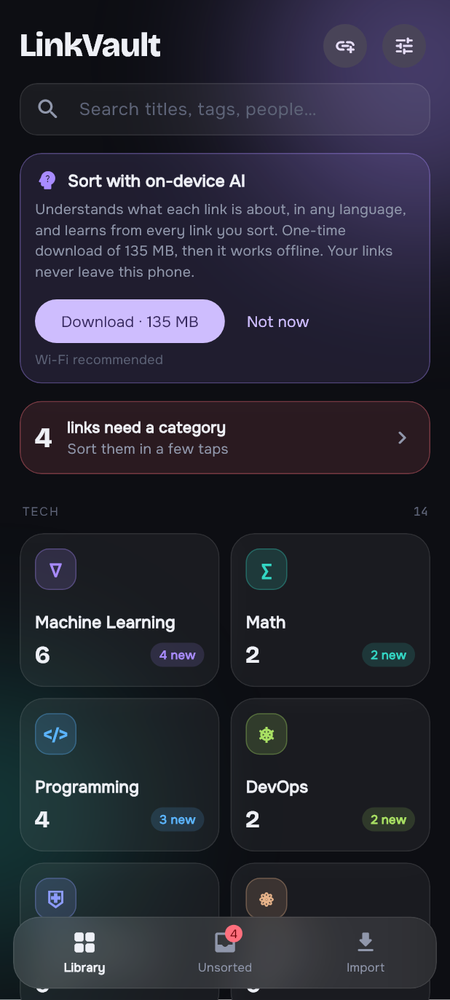
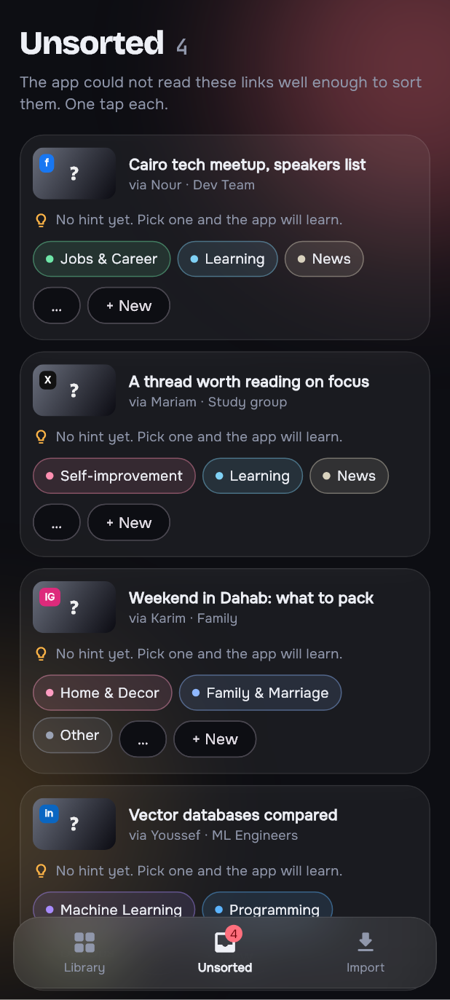
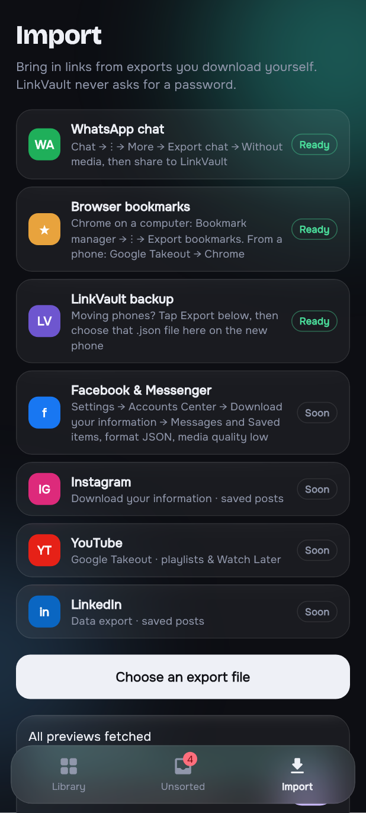
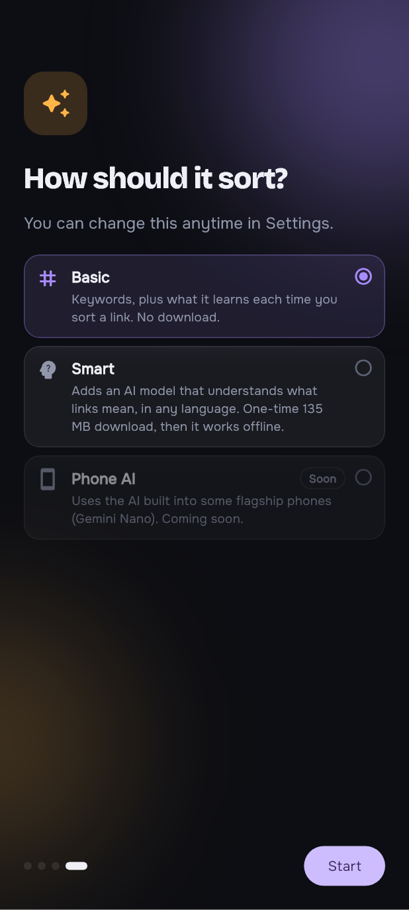
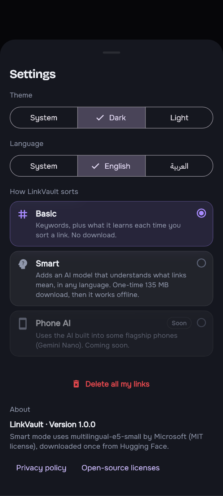
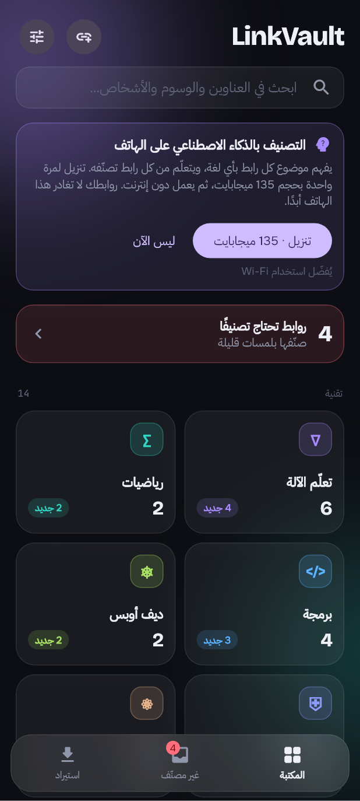

# LinkVault

**All the links people send you, sorted by topic, on your phone. No account, no server.**

That YouTube lecture from a group chat, the article a friend sent last month, the course you bookmarked: LinkVault collects them in one place and sorts them by what they're about, in Arabic or English.

**[See the full page with every screen →](https://mohamed-ibrahim47.github.io/linkvault-showcase/)**

> The source code is private. This page shows what the app does and how it works.

<!-- Store badge goes here once the app is live on the Galaxy Store -->

## Screenshots

Real screens from the app, with a made-up library.

| Library | A category | Unsorted | Import |
|---|---|---|---|
|  |  |  |  |

| A link | Sorting modes | Settings | بالعربي |
|---|---|---|---|
|  |  |  |  |

## The core idea: it never sees a password

Links come in only in ways you start yourself:

- **The share sheet.** Tap Share on any link in any app and pick LinkVault. It's saved instantly and sorted.
- **Paste.** The + button adds a link, already filled in if one is on your clipboard.
- **Exports you download yourself.** WhatsApp's "Export chat" or your browser's bookmarks file. LinkVault reads the file on your phone and never logs in anywhere.

Everything is stored and processed on the device. There is no LinkVault server.

## What it does

- **Imports**
  - **WhatsApp chats:** Android, iPhone and Arabic-format exports, `.txt` or `.zip`.
  - **Browser bookmarks:** Chrome, Edge, Firefox, Safari or Google Takeout. Your folder names become sorting hints.
  - **LinkVault backups:** export your library, then import it on a new phone.
- **No duplicates.** Import the same chat again and only the new links come in. The same link from two people is one link with two senders.
- **Previews.** Titles and pictures are read in the background, with a Wi-Fi-only option and polite pacing per site.
- **Organisation.** Categories you can rename, recolour and add to, tags, notes, and a status for each link: New, Done or Archived. Tap a link and it opens in its own app.
- **Unsorted with suggestions.** Links the app isn't sure about wait with their three best guesses. One tap sorts them, and teaches the app.
- **Delete** a link with Undo, hold to select several, or delete everything from Settings.
- **Search** by title, description, tags, your notes, or who sent it and in which chat.
- **Arabic and English** with full right-to-left layout, and a welcome tour on first launch.

## How the sorting works

You pick a mode in the welcome tour or in Settings:

| Mode | How it sorts |
|---|---|
| **Basic** (default) | Keywords in English and Arabic, plus what it learns each time you move a link. No download. |
| **Smart** | Adds multilingual-e5-small (135 MB, downloaded once). Each link becomes a "meaning" vector, and a small classifier trained **on the phone, on your own sorted links** decides where it goes. |
| **Phone AI** | Coming: the AI built into some flagship phones. |

Every step only sorts a link when it's confident. The rest go to **Unsorted** with suggestions, because a link in the wrong place is worse than one waiting for a tap.

Measured on one real library against 227 links labelled by hand, without looking at the app's answers:

- Smart mode sorted more links than keywords alone, with **no extra wrong sorts**.
- For Unsorted links a person could place, the right category was among Smart's three suggestions **33 times out of 38**.
- Weighted word scoring and Naive Bayes were tested as automatic sorters too. They added about one wrong sort for every right one, so in the app they only **suggest**.

## Privacy

No account, no login, no analytics, no ads. The app goes online only to read link previews and, in Smart mode, to download the model once. Full details in the **[privacy policy](https://mohamed-ibrahim47.github.io/linkvault-showcase/privacy.html)**.

## How it's built

- **Flutter**, for Android 7 and newer.
- **SQLite** on the device, plus a JSON export that can be imported back.
- The AI model runs through **ONNX Runtime** in native Android code on a background thread. Tokenizing, the keyword scorer and the classifier are pure Dart, so they're unit-tested and run in background isolates.
- A foreground notification keeps long imports and preview reads alive when you leave the app.
- 99 automated tests cover the parsers, URL cleaning, the tokenizer, the sorters, restore, and every main screen in both languages on phone, Fold and tablet sizes and with large text.

## Coming next

- Facebook and Messenger, Instagram, YouTube (Takeout) and LinkedIn imports
- Phone AI on flagship phones (Gemini Nano)
- Automatic backup to your own Google Drive 

---

Made by [Mohamed Ibrahim](https://github.com/mohamed-ibrahim47) · [Privacy policy](https://mohamed-ibrahim47.github.io/linkvault-showcase/privacy.html) · [Early design mockup](https://mohamed-ibrahim47.github.io/linkvault-showcase/mockup.html)
